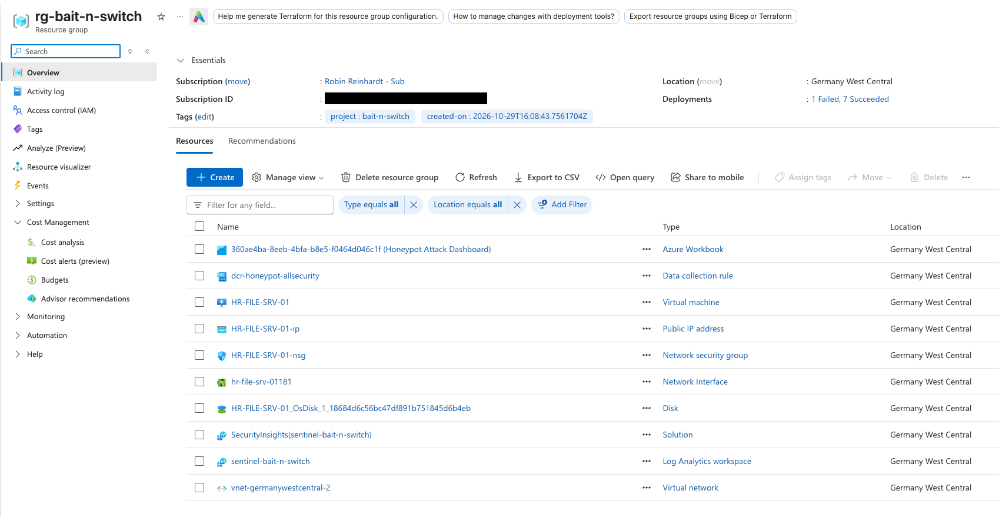
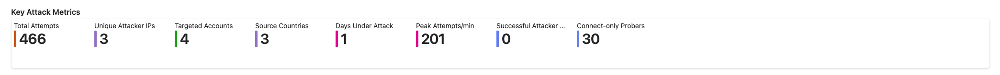
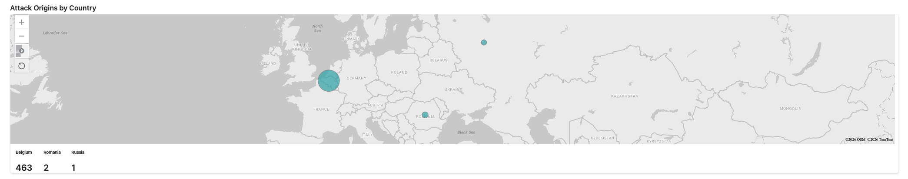
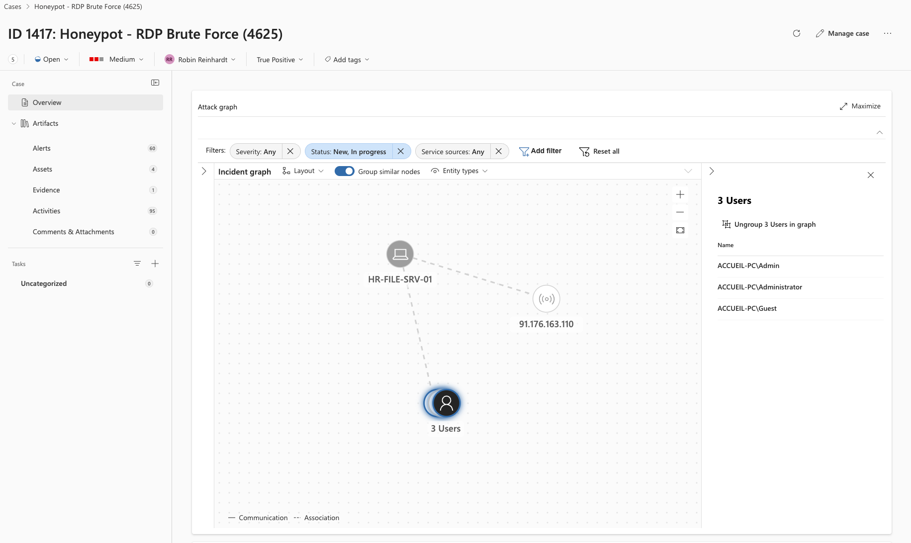
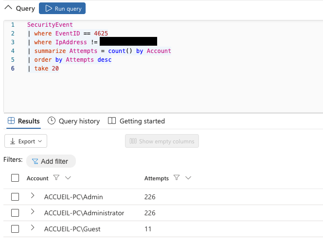
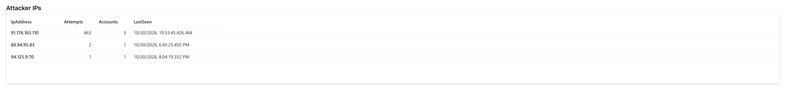
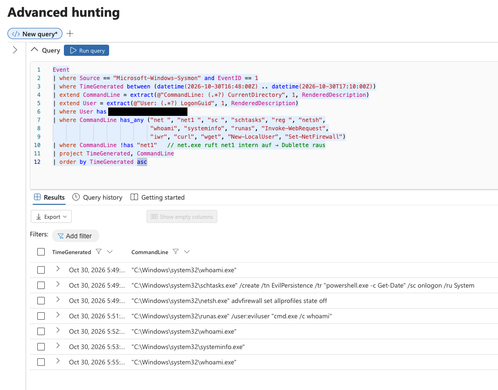
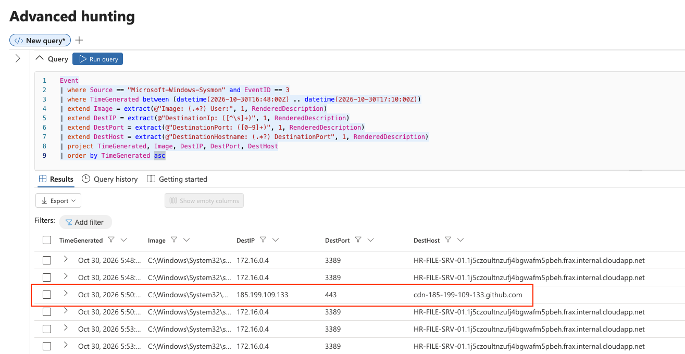
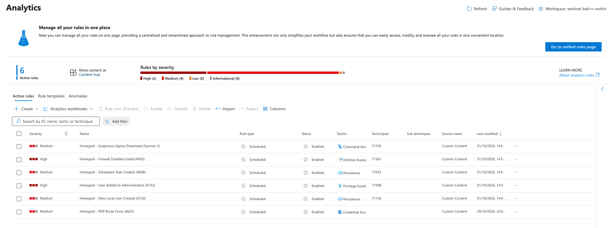
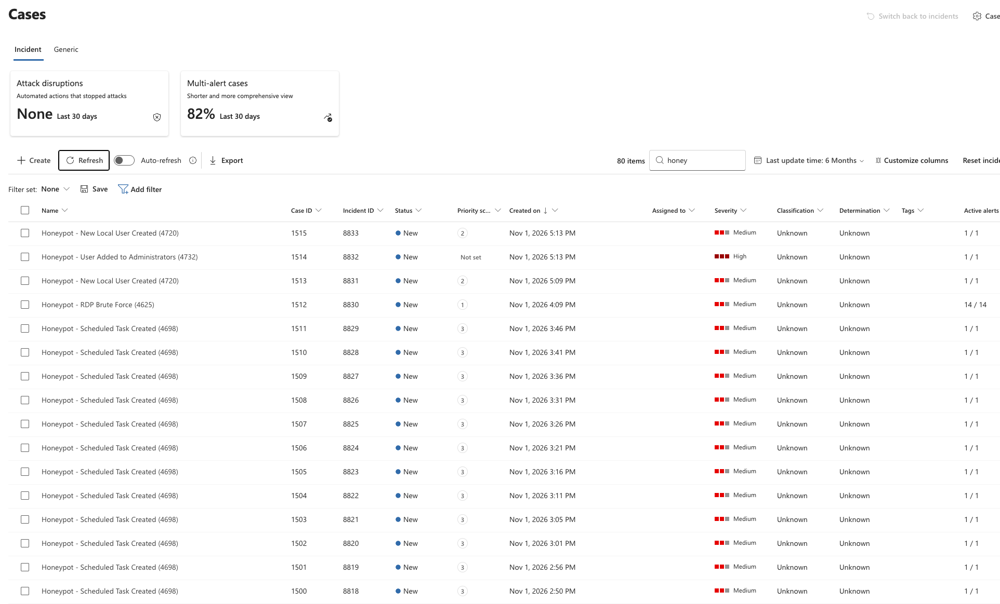

# Bait n' Switch — Azure RDP-Honeypot mit Microsoft Sentinel

**Deutsch** · [English](README.md)

Ein bewusst verwundbarer Windows-Server-Honeypot in Azure, durchgängig überwacht mit
Microsoft Sentinel. Ziel: echte Internet-Angreifer erfassen, einen kontrollierten
Peer-Angriff per Log-Forensik rekonstruieren und die Aktivität visualisieren — bereitgestellt
als Infrastructure-as-Code statt per Klickstrecke.

> **Weiterbildungsprojekt** (Cybersteps, Modul 3). Die VM (`HR-FILE-SRV-01`) war nur wenige
> Tage über RDP (3389) öffentlich exponiert und wurde danach deallocated.

---

## Hinweis zu geschwärzten Daten

Eigene und Classmate-IP-Adressen sind aus Datenschutzgründen geschwärzt. Angreifer-IP-Adressen
bleiben sichtbar, da sie Teil der Threat-Analyse sind und ohnehin in öffentlichen
Threat-Intelligence-Quellen auftauchen. Subscription-, Tenant- und Workspace-IDs sind geschwärzt.

---

## 1. Architektur & Setup

```
HR-FILE-SRV-01 (Win Server 2025)
      │  AzureMonitorWindowsAgent (AMA) + System-Assigned Managed Identity
      │  Sysmon (SwiftOnSecurity-Config)
      ▼
Data Collection Rule  ── Security!*  +  Sysmon / PowerShell / TaskScheduler Operational
      ▼
Log Analytics Workspace  (sentinel-bait-n-switch, germanywestcentral)
      ▼
Microsoft Sentinel  — Analytics Rule → Incident → Investigation Graph → Workbook
```

Bereitgestellt per `az` CLI (siehe `terraform/` für die IaC-Variante):
- VM + NSG-Regel, die Port 3389 für `Any` öffnet
- AMA-Extension + **System-Assigned Managed Identity** (nötig, damit der Agent sich authentifiziert)
- DCR, die `Security!*` **und** die Sysmon-/PowerShell-/TaskScheduler-Operational-Channels sammelt
- DCR-zu-VM-Zuordnung (Association)
- Sysmon mit der SwiftOnSecurity-Konfiguration installiert (MITRE-getaggte Regeln)



---

## 2. Statistik (Phase 6)

Kennzahlen über den Expositionszeitraum (nur externe Angreifer; eigene/Test-/Classmate-IPs ausgeschlossen):

| Kennzahl | Wert |
|---|---|
| Fehlgeschlagene Anmeldeversuche gesamt | **466** |
| Eindeutige Angreifer-IPs | 3 |
| Angegriffene Konten | 4 |
| Herkunftsländer | 3 |
| Tage unter Angriff | 1 |
| Spitzenwert Versuche / Minute | **201** |
| **Erfolgreiche Angreifer-Logins** | **0** |
| Reine Port-Prober (Sysmon Event 3) | 27 |

**Top-Angreifer:** `91.176.163.110` (Belgien) — 463 Fehlversuche in 139 s (**3,33/s**),
gegen `Administrator`, `Admin`, `Guest`.




### Angreifer-Typologie

Drei unterschiedliche Verhaltensmuster traten hervor (nur durch Kombination von Security-Log
und Sysmon-Netzwerk-Events sichtbar):

1. **Aktive Brute-Forcer** — verbinden **und** schicken Credentials, hohe Frequenz, kurzer
   Burst (z. B. Belgien-IP, 463 Versuche).
2. **Persistente Prober** — tasten den RDP-Port wiederholt an, senden aber nie Credentials.
   Eine IP probte ~19 Stunden am Stück, **im Security-Log (4625) unsichtbar** — nur Sysmon
   Event 3 deckte sie auf.
3. **Opportunistische Scanner** — 1–4 Verbindungen, einmalig, weltweit verstreut
   (Internet-Grundrauschen).




### Benutzernamen-Wörterbücher

Verschiedene Bots nutzten verschiedene Wortlisten — ein Beleg für unabhängige Kampagnen:
- `Administrator` / `Admin` / `Guest` (Windows-Defaults, Workstation-Name `ACCUEIL-PC`)
- `Test` (generische Schwach-Account-Liste, andere Quell-IPs)



---

## 3. Der Classmate-Angriff — Forensische Rekonstruktion (Phase 4)

Ein Classmate meldete sich per RDP an (Session über `TargetLogonId 0x9235dc`, LogonType 10
isoliert) und führte einen scriptbasierten Angriff durch. Rekonstruierte Timeline (Zeiten UTC):

| Zeit | Aktion | Befehl | MITRE |
|---|---|---|---|
| 16:48 | RDP-Login | Session `0x9235dc` | T1021.001 |
| 16:49:08 | User anlegen | `net user eviluser P@ssw0rd123! /add` | T1136.001 |
| 16:49:16 | Zu Admins hinzufügen | `net localgroup Administrators eviluser /add` | T1098 / T1078 |
| 16:49:27 | Recon | `whoami` | T1033 |
| 16:49:52 | Scheduled Task | `schtasks /create /tn EvilPersistence /tr "powershell -c Get-Date" /sc onlogon /ru System` | T1053.005 |
| 16:49:58 | Firewall deaktivieren | `netsh advfirewall set allprofiles state off` | T1562.004 |
| 16:51:18 | Registry Run-Key | `reg add ...\CurrentVersion\Run /v Updater /d C:\Users\Public\loot.txt` | T1547.001 |
| 16:51:25 | Dienst anlegen | `sc create EvilSvc binPath="cmd.exe /c echo pwned" start=auto` | T1543.003 |
| 16:55:29 | Lateral-Test | `net use \\localhost\C$ /user:eviluser ...` | T1021.002 |
| 16:56:13 | Zweiter Dienst | `sc create LateralSvc binPath="cmd.exe /c echo moved"` | T1543.003 |



### Verifikation — „Habe ich etwas übersehen?" (Phase 4, Schritt 4)

| Erwartete Aktion | Erfasst? | Über |
|---|---|---|
| RDP-Login | ✅ | 4624 (LogonType 10) |
| Recon (whoami, systeminfo) | ✅ | Sysmon 1 |
| Neuer User `eviluser` | ✅ | 4720 + Sysmon 1 |
| Zu Administrators hinzugefügt | ✅ | 4732 + Sysmon 1 |
| Firewall deaktiviert | ✅ | netsh via Sysmon 1 |
| Scheduled Task | ✅ | 4698 + Sysmon 1 |
| Registry Run-Key | ✅ | Sysmon 13 |
| **PowerShell-Download** | ⚠️ **teilweise** | nur Sysmon 3 (Netzwerk) — kein Befehls-Detail |
| *Bonus:* `EvilSvc`, `LateralSvc` (nicht in der Vorgabe) | ✅ | Sysmon 1 (T1543) |

**Das Teilsichtbarkeits-Finding (Kern-Lektion):** Der Classmate bestätigte, eine Datei per
PowerShell heruntergeladen zu haben (seine eigene Projekt-README, über HTTPS). Der Download
**wurde** erfasst — Sysmon Event 3 zeigt die ausgehende Verbindung nach `185.199.109.133:443`
(`cdn-...github.com`) um 16:50. Doch das Bild ist unvollständig, und der Weg dorthin legte zwei
echte Detection-Fallstricke offen:

- **Nur die Netzwerk-Ebene sah es.** Sysmon Event 3 belegt, *dass* eine Verbindung zu GitHub
  stattfand, aber nicht *welcher Befehl* sie auslöste. `Invoke-WebRequest` läuft in-process
  innerhalb von PowerShell, es gibt also kein Prozess-Event (Sysmon 1 / 4688), und **Script
  Block Logging (4104) war nicht aktiviert** — die eigentliche Befehlszeile ist damit nicht
  rekonstruierbar.
- **Ein zu enger Filter versteckt echte Aktivität.** Die ausgehende Verbindung stammte in den
  Logs nicht von `powershell.exe`, sodass ein erster Hunt mit `Image has "powershell"` sie
  komplett verfehlte. Erst eine ungefilterte Event-3-Abfrage über das Session-Fenster machte
  sie sichtbar. *Man findet nur, wonach man fragt* — zu spezifische Filter sind selbst ein
  blinder Fleck.

Ein lehrbuchmäßiger **T1105 (Ingress Tool Transfer)** Living-off-the-Land-Download: auf der
Netzwerk-Ebene erkennbar, aber nur mit breitem Hunting und ohne Script Block Logging nur
teilweise.
→ Fix im Hardening-Abschnitt.



Hinweis: Die `185.199.109.133`-Verbindung bleibt in den Screenshots sichtbar, da es sich um
einen öffentlichen GitHub-CDN-Endpunkt handelt, nicht um eine private Adresse.

---

## 4. Detection Engineering — von Hunting zu Regeln

Die Forensik-Queries oben finden Angriffe *im Nachhinein*. Um sie *während sie passieren* zu
erkennen, wurde die Hunting-Logik in sechs eigene **Analytics Rules** überführt, jede einer
MITRE-Technik zugeordnet. Eine (RDP Brute Force) feuerte auf echten Internet-Traffic, die
übrigen wurden mit kontrollierten Test-Events verifiziert.

| Regel | Logik | MITRE | Severity | Verifiziert |
|---|---|---|---|---|
| RDP Brute Force | 4625 ≥3 / IP | T1110 | Medium | ✅ echter Angriff |
| New Local User | 4720 | T1136 | Medium | ✅ Test |
| User Added to Administrators | 4732 | T1098 | High | ✅ Test |
| Scheduled Task Created | 4698 | T1053 | Medium | ✅ Test (siehe FP-Hinweis) |
| Suspicious Egress Download | Sysmon 3, Port 443 | T1105 | Medium | ✅ Test |
| Firewall Disabled | Sysmon 1, netsh/Set-NetFirewallProfile | T1562 | High | ⚠️ FN (siehe Hinweis) |




### Detection-Lektionen

Das Bauen und Testen dieser Regeln brachte mehrere reale Detection-Fallstricke zutage — der
eigentliche Wert dieser Phase. **Eine aktivierte Regel ist nicht automatisch eine
funktionierende Regel.**

1. **Eine Regel kann nicht auf ein Event feuern, das nie erzeugt wurde.** Ein früher Test
   produzierte keine `4720`/`4732`-Incidents. Ursache war nicht die Regel — der Test-User
   wurde nie angelegt, weil ein `az vm run-command` mitten im Lauf abgebrochen wurde und ein
   zweiter kollidierte. *Erste Frage bei jedem „Regel feuert nicht"-Fall: Existierte das Event
   überhaupt?*

2. **Zu breit → Alert-Fatigue (False Positives).** Die `4698`-Regel (Scheduled Task) feuerte
   auf **jede** Task-Erstellung — auch auf die vielen legitimen, die Windows im Hintergrund
   anlegt — und erzeugte alle 5 Minuten eine Flut nahezu identischer Incidents. Eine brauchbare
   Regel muss auf *verdächtige* Merkmale eingrenzen (Task läuft als SYSTEM und startet
   powershell/cmd, ungewöhnlicher Name), nicht auf jedes `4698`. Tuning gehört zur Arbeit.

3. **Zu eng → False Negative.** Die Firewall-Regel feuerte **nicht**, obwohl das
   `netsh advfirewall ... state off`-Event erfasst wurde. Drei Ursachen wirkten zusammen:
   - `has "netsh advfirewall"` sucht diese **Phrase als Token-Folge**. Im Log steht der Befehl
     als `"...netsh.exe" advfirewall` — die Wörter sind durch `.exe"` getrennt, das Token
     matcht also nie. KQL `has` ist token-basiert, keine Teilstring-Suche. (Fix: einzelne
     Tokens wie `has "advfirewall"`, oder `contains`.)
   - Ein zusätzlicher `has_any ("state off", ...)`-Filter und ein `User has "azureuser"`-Constraint
     verengten sie weiter.
   - **Der Ausführungs-Kontext zählt.** Aktionen, die per `az vm run-command` ausgelöst werden,
     laufen als `NT AUTHORITY\SYSTEM`, nicht als interaktiver User — eine Regel, die auf den
     ausführenden User filtert, verpasst sie damit. (Regeln, die auf das *Ziel* schauen — ein
     neues Konto, eine Gruppenänderung — feuerten trotzdem, weil sie nicht davon abhängen,
     *wer* den Befehl ausführte.)

   Diese Regel bleibt als **dokumentiertes False-Negative-Beispiel** bestehen: Die Logik wurde
   im Test als korrekt nachgewiesen, aber die Defender-/Azure-Portal-Validierung blockierte die
   vereinfachte Version wiederholt — und eine funktionierende Regel im falschen Kontext ist
   lehrreicher als eine stillschweigend korrigierte.

4. **Entity-Mapping muss zum Query-Output passen.** Eine Spalte aus der Regel-Query zu
   entfernen, während eine Entität noch darauf mappte, löste ein undurchsichtiges
   „validation failed" ohne markiertes Feld aus. Nur Entitäten auf Spalten mappen, die die
   Query auch wirklich liefert; und nur das mappen, was man braucht.

**Die Meta-Lektion — die zwei Fehlertypen der Detection stehen in Spannung zueinander:** Die
`4698`-Regel war *zu breit* (FP-Flut → Spezifität nötig); die Firewall-Regel war *zu eng*
(FN-Miss → Einfachheit nötig). Es gibt kein universelles „richtig" — der Kontext (ein
Honeypot, auf dem keine legitime Admin-Aktivität existiert) entscheidet. Filter erst
hinzufügen, nachdem man echte False Positives gesehen hat, nicht vorbeugend.

---

## 5. Innovationen (Phase 6)

- **Infrastructure-as-Code** — der gesamte Honeypot per `az` CLI bereitgestellt, als Terraform
  festgehalten (`terraform/main.tf`). Reproduzierbar, versionierbar, teardown-sicher — anders
  als der Klickstrecken-Weg, den die Anleitung voraussetzt.
- **Sysmon + SwiftOnSecurity-Config** — vollständige Command-Line-Erfassung und **automatisches
  MITRE-ATT&CK-Tagging** der Events (z. B. das `sc create` des Classmates wurde automatisch mit
  `T1031,T1050` getaggt). Das machte die Forensik auf Befehls-Ebene erst möglich.
- **Von Hunting zu Detection** — sechs eigene MITRE-getaggte Analytics Rules (Abschnitt 4), die
  nachträgliche Forensik-Queries in Live-Detection überführen, mit den Tuning-Lektionen, die
  dazugehören.
- **Multi-Source-Korrelations-Erkenntnis** — gezeigt, dass das Security-Log allein den
  hartnäckigsten Prober verpasst, und dass ein PowerShell-Download nur auf der Netzwerk-Ebene
  (Sysmon Event 3) sichtbar ist; erst die Kombination der Quellen — und *kein* Über-Filtern —
  ergibt das vollständige Bild.

---

## 6. Hardening — „kein Lamm zur Schlachtbank mehr" (Phase 6)

| Schwachstelle | Fix |
|---|---|
| RDP (3389) für `Any` offen | RDP nie ins Internet exponieren — VPN / Azure Bastion / Just-in-Time-Access |
| Credential-Brute-Force möglich | Account-Lockout-Policy; starke/rotierte Passwörter (hier gehalten — 0 Breaches) |
| NTLM über offenes RDP | Network Level Authentication (NLA) erzwingen |
| PowerShell-Downloads ohne Befehls-Detail | **PowerShell Script Block Logging aktivieren** (4104) — die Netzwerk-Ebene (Sysmon 3) zeigt *dass* ein Download stattfand, nicht den Befehl dahinter |
| Local-Admin-Wildwuchs | Einschränken, wer Konten/Dienste anlegen darf; 4720/4732/4697 überwachen |
| Dauerhafte Exposition/Kosten | Deallocaten, wenn nicht gebraucht (Telemetrie bleibt 90 Tage im Workspace) |

---

## 7. Lessons Learned / Troubleshooting

Die offizielle Anleitung war an mehreren Stellen veraltet (Microsoft hat Features ins
Defender-Portal verschoben). Bemerkenswerte Hürden, für die nächste Person dokumentiert:

- **Content Hub & Analytics ins Defender-Portal verschoben** — die Azure-Portal-Seiten leiten
  jetzt weiter. Workbooks/Logs funktionieren weiterhin im Azure-Portal.
- **Workspace-Scoping-Falle** — das Defender-Portal wählt standardmäßig den Primary- (Lab-)
  Workspace und versteckt den eigenen im Scope-Dialog. Der Aufbau über das **Azure-Portal**
  umgeht das.
- **Keine Managed Identity → kein Heartbeat** — der CLI-Weg legt die System-Assigned Identity
  der VM, die AMA zur Authentifizierung braucht, nicht automatisch an. Alles meldete
  „Succeeded", aber **es flossen keine Daten**, bis `az vm identity assign` lief. Klassisches
  „alles grün, keine Daten".
- **DCR-Preset vs. generischer Wizard** — der generische Azure-Monitor-DCR-Wizard hat kein
  „All Security Events"-Preset; stattdessen den XPath `Security!*` nutzen.
- **Regel-Bearbeitung nur im Azure-Portal** — die Defender-„Unified Rules Page" ist für
  Analytics Rules nur lesend; editiert wird im Azure-Portal.

---

## Repository-Struktur

```
.
├── README.md                 # englische Version — Quelle für den PDF-Report
├── README.de.md              # diese Datei (DE)
├── terraform/
│   ├── main.tf               # IaC: DCR, AMA, Identity, Association, NSG
│   ├── sentinel-rules.tf     # Analytics Rule
│   └── install-sysmon.ps1    # Sysmon
├── queries/
│   ├── triage.md             # Phase 3 — Angreifer-Triage-KQL
│   └── forensics.md          # Phase 4 — Classmate-Forensik-KQL
├── screenshots/
├── .gitleaks.toml            # blockiert die eigene IP beim Commit
└── .pre-commit-config.yaml
```
