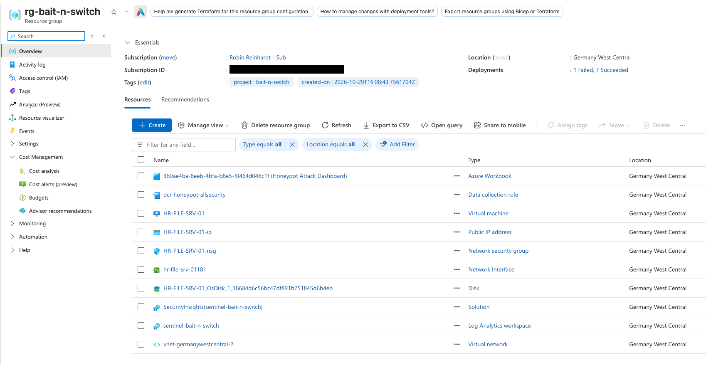
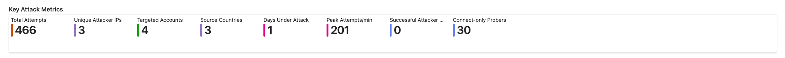
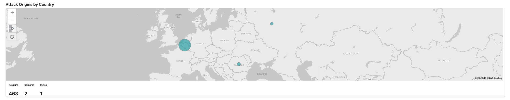
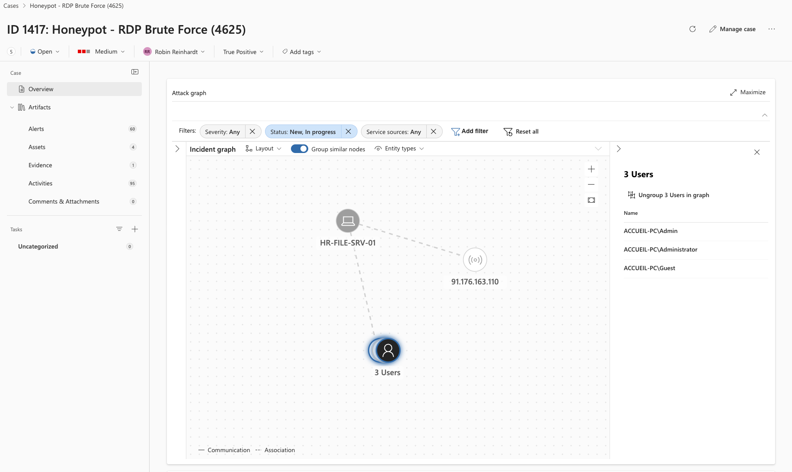
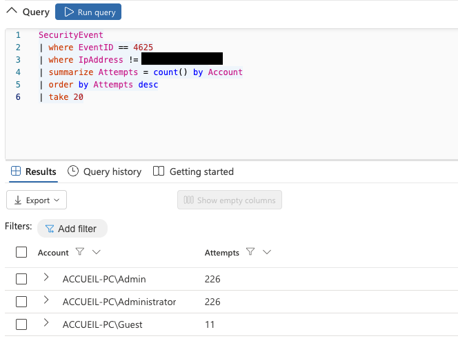
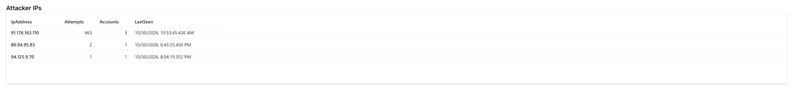
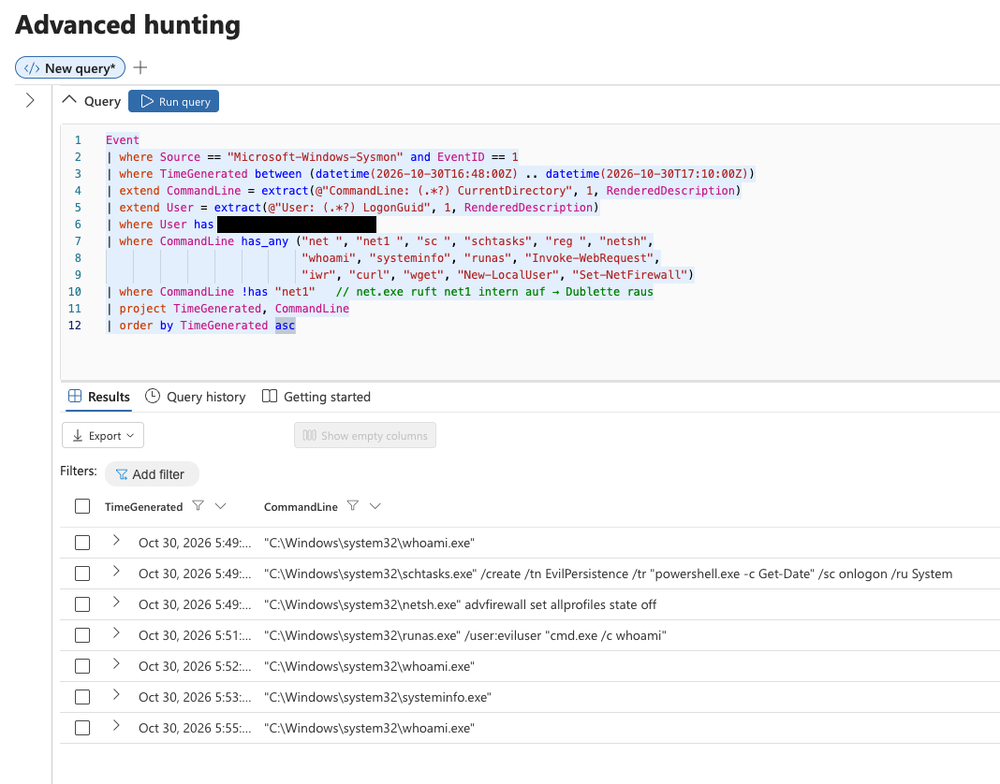
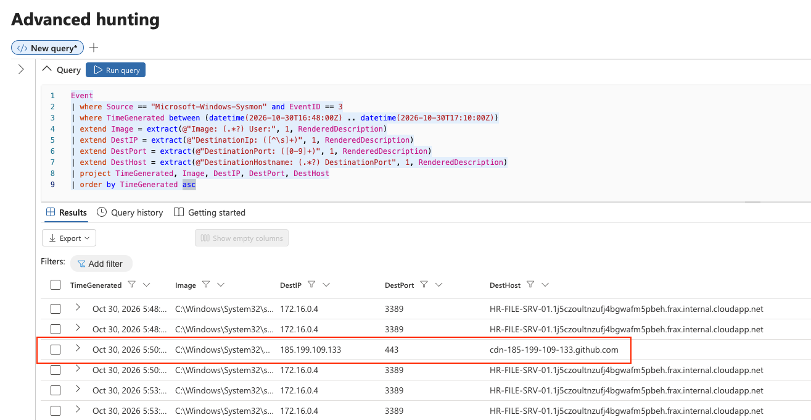
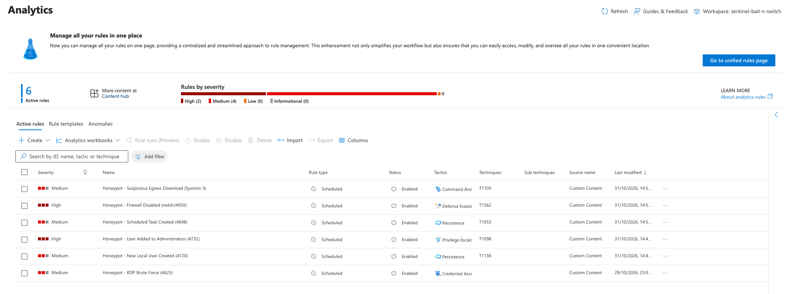
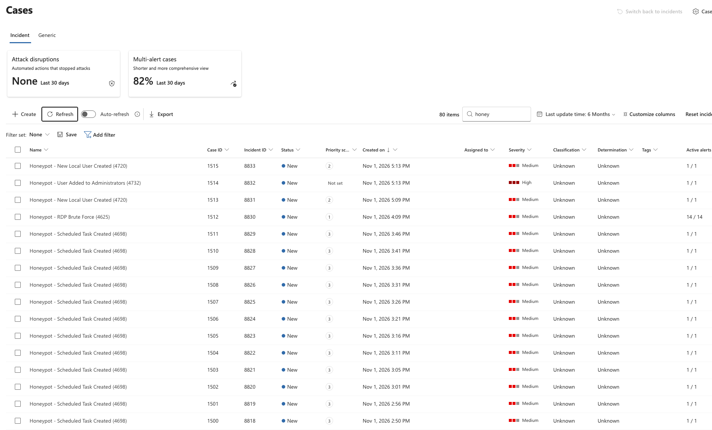

# Bait n' Switch — Azure RDP Honeypot with Microsoft Sentinel

[Deutsch](README.de.md) · **English**

A purposely vulnerable Windows Server honeypot deployed in Azure, monitored end-to-end
with Microsoft Sentinel. Built to capture live internet attackers, reconstruct a
controlled peer attack through log forensics, and visualize the activity — provisioned
as Infrastructure-as-Code rather than click-ops.

> **Training project** (Cybersteps, Module 3). The VM (`HR-FILE-SRV-01`) was exposed to
> the public internet on RDP (3389) for a few days only, then deallocated.

---

## Note on redacted data

Own and classmate IP addresses are redacted for privacy. Attacker IP addresses are
retained, as they are part of the threat analysis and appear in public threat-intelligence
sources anyway. Subscription, tenant, and workspace IDs are redacted.

---

## 1. Architecture & Setup

```
HR-FILE-SRV-01 (Win Server 2025)
      │  AzureMonitorWindowsAgent (AMA) + System-Assigned Managed Identity
      │  Sysmon (SwiftOnSecurity config)
      ▼
Data Collection Rule  ── Security!*  +  Sysmon / PowerShell / TaskScheduler Operational
      ▼
Log Analytics Workspace  (sentinel-bait-n-switch, germanywestcentral)
      ▼
Microsoft Sentinel  — Analytics Rule → Incident → Investigation Graph → Workbook
```

Provisioned via `az` CLI (see `terraform/` for the IaC version):
- VM + NSG rule opening 3389 to `Any`
- AMA extension + **System-Assigned Managed Identity** (required for the agent to authenticate)
- DCR collecting `Security!*` **and** the Sysmon / PowerShell / TaskScheduler operational channels
- DCR-to-VM association
- Sysmon installed with the SwiftOnSecurity configuration (MITRE-tagged rules)



---

## 2. Statistics (Phase 6)

Key metrics over the exposure window (external attackers only; own/test/classmate IPs excluded):

| Metric | Value |
|---|---|
| Total failed login attempts | **466** |
| Unique attacker IPs | 3 |
| Targeted accounts | 4 |
| Source countries | 3 |
| Days under attack | 1 |
| Peak attempts / minute | **201** |
| **Successful attacker logins** | **0** |
| Connect-only probers (Sysmon Event 3) | 27 |

**Top attacker:** `91.176.163.110` (Belgium) — 463 failed attempts in 139 s (**3.33/s**),
targeting `Administrator`, `Admin`, `Guest`.




### Attacker typology

Three distinct behaviours emerged (visible only by combining Security log + Sysmon network events):

1. **Active brute-forcers** — connect **and** push credentials, high frequency, short burst
   (e.g. Belgium IP, 463 attempts).
2. **Persistent probers** — repeatedly touch the RDP port but never submit credentials.
   One IP probed ~19 hours straight, **invisible in the Security log (4625)** — only
   Sysmon Event 3 revealed it.
3. **Opportunistic scanners** — 1–4 connects, one-off, globally spread (internet background noise).




### Username dictionaries

Different bots used different wordlists — evidence of independent campaigns:
- `Administrator` / `Admin` / `Guest` (Windows defaults, workstation name `ACCUEIL-PC`)
- `Test` (generic weak-account list, different source IPs)



---

## 3. The Classmate Attack — Forensic Reconstruction (Phase 4)

A classmate logged in via RDP (session isolated by `TargetLogonId 0x9235dc`, LogonType 10)
and performed a scripted attack. Reconstructed timeline (times UTC):

| Time | Action | Command | MITRE |
|---|---|---|---|
| 16:48 | RDP login | session `0x9235dc` | T1021.001 |
| 16:49:08 | Create user | `net user eviluser P@ssw0rd123! /add` | T1136.001 |
| 16:49:16 | Add to admins | `net localgroup Administrators eviluser /add` | T1098 / T1078 |
| 16:49:27 | Recon | `whoami` | T1033 |
| 16:49:52 | Scheduled task | `schtasks /create /tn EvilPersistence /tr "powershell -c Get-Date" /sc onlogon /ru System` | T1053.005 |
| 16:49:58 | Disable firewall | `netsh advfirewall set allprofiles state off` | T1562.004 |
| 16:51:18 | Registry Run key | `reg add ...\CurrentVersion\Run /v Updater /d C:\Users\Public\loot.txt` | T1547.001 |
| 16:51:25 | Create service | `sc create EvilSvc binPath="cmd.exe /c echo pwned" start=auto` | T1543.003 |
| 16:55:29 | Lateral test | `net use \\localhost\C$ /user:eviluser ...` | T1021.002 |
| 16:56:13 | Second service | `sc create LateralSvc binPath="cmd.exe /c echo moved"` | T1543.003 |



### Verification — "did you miss anything?" (Phase 4, step 4)

| Expected action | Captured? | Via |
|---|---|---|
| RDP login | ✅ | 4624 (LogonType 10) |
| Recon (whoami, systeminfo) | ✅ | Sysmon 1 |
| New user `eviluser` | ✅ | 4720 + Sysmon 1 |
| Add to Administrators | ✅ | 4732 + Sysmon 1 |
| Disable firewall | ✅ | netsh via Sysmon 1 |
| Scheduled task | ✅ | 4698 + Sysmon 1 |
| Registry Run key | ✅ | Sysmon 13 |
| **PowerShell download** | ⚠️ **partial** | Sysmon 3 (network) only — no command-level detail |
| *Bonus:* `EvilSvc`, `LateralSvc` (not on the brief) | ✅ | Sysmon 1 (T1543) |

**The partial-visibility finding (key lesson):** The classmate confirmed downloading a file
via PowerShell (their own project README, over HTTPS). The download **was** captured — Sysmon
Event 3 shows the outbound connection to `185.199.109.133:443` (`cdn-...github.com`) at 16:50.
But the picture is incomplete, and getting to it exposed two real detection pitfalls:

- **Only the network layer saw it.** Sysmon Event 3 proves *that* a connection to GitHub
  happened, but not *which command* caused it. `Invoke-WebRequest` runs in-process inside
  PowerShell, so there is no process event (Sysmon 1 / 4688), and **Script Block Logging
  (4104) was not enabled** — so the actual command line is unrecoverable.
- **A too-narrow filter hides real activity.** The outbound connection did not originate from
  `powershell.exe` in the logs, so an initial hunt filtered on `Image has "powershell"` missed
  it entirely. Only an unfiltered Event 3 query over the session window surfaced it. *You only
  find what you ask for* — over-specific filters are themselves a blind spot.

A textbook **T1105 (Ingress Tool Transfer)** living-off-the-land download: detectable at the
network layer, but only with broad hunting and only partially without Script Block Logging.
→ Fix in Hardening below.



Note: the `185.199.109.133` connection is retained in screenshots as it is a public GitHub
CDN endpoint, not a private address.

---

## 4. Detection Engineering — from hunting to rules

The forensic queries above find attacks *after the fact*. To detect them *as they happen*,
the hunting logic was turned into six custom **Analytics Rules**, each mapped to a MITRE
technique. One (RDP Brute Force) fired on real internet traffic; the others were verified
with controlled test events.

| Rule | Logic | MITRE | Severity | Verified |
|---|---|---|---|---|
| RDP Brute Force | 4625 ≥3 / IP | T1110 | Medium | ✅ real attack |
| New Local User | 4720 | T1136 | Medium | ✅ test |
| User Added to Administrators | 4732 | T1098 | High | ✅ test |
| Scheduled Task Created | 4698 | T1053 | Medium | ✅ test (see FP note) |
| Suspicious Egress Download | Sysmon 3, port 443 | T1105 | Medium | ✅ test |
| Firewall Disabled | Sysmon 1, netsh/Set-NetFirewallProfile | T1562 | High | ⚠️ FN (see note) |




### Detection lessons learned

Building and testing these rules surfaced several real-world detection pitfalls — the
actual value of this phase. **An enabled rule is not a working rule.**

1. **A rule can't fire on an event that was never generated.** An early test produced no
   `4720`/`4732` incidents. Root cause was not the rule — the test user was never created,
   because an `az vm run-command` had been cancelled mid-run and a second one collided.
   *First question in any "rule didn't fire" case: did the event exist at all?*

2. **Too broad → alert fatigue (false positives).** The `4698` (Scheduled Task) rule fired
   on **every** task creation — including the many legitimate ones Windows schedules in the
   background — producing a flood of near-identical incidents every 5 minutes. A usable rule
   needs to narrow on *suspicious* characteristics (task runs as SYSTEM and launches
   powershell/cmd, unusual name), not match every `4698`. Tuning is part of the job.

3. **Too narrow → false negative.** The Firewall rule did **not** fire even though the
   `netsh advfirewall ... state off` event was captured. Three causes compounded:
   - `has "netsh advfirewall"` searches for that **phrase as a token sequence**. In the log
     the command is `"...netsh.exe" advfirewall` — the words are split by `.exe"`, so the
     token never matches. KQL `has` is token-based, not substring. (Fix: single tokens like
     `has "advfirewall"`, or `contains`.)
   - An extra `has_any ("state off", ...)` filter and a `User has "azureuser"` constraint
     narrowed it further.
   - **Execution context matters.** Actions triggered via `az vm run-command` run as
     `NT AUTHORITY\SYSTEM`, not as the interactive user — so any rule filtering on the
     executing user misses them. (Rules keying on the *target* — a new account, a group
     change — fired regardless, because they don't depend on *who* ran the command.)

   This rule is left in place as a **documented false-negative example**: the logic was
   proven correct in test, but the Defender/Azure portal validation blocked the simplified
   version repeatedly, and a working rule in the wrong context is more instructive than a
   silently corrected one.

4. **Entity mapping must match the query output.** Removing a column from a rule's query
   while an entity still mapped to it caused an opaque "validation failed" with no field
   highlighted. Map only entities to columns the query actually returns; map only what you
   need.

**The meta-lesson — the two failure modes of detection sit in tension:** the `4698` rule was
*too broad* (FP flood → specificity needed); the Firewall rule was *too narrow* (FN miss →
simplicity needed). There is no universal "right" — the context (a honeypot, where no
legitimate admin activity exists) decides. Add filters only after seeing real false
positives, not pre-emptively.

---

## 5. Innovations (Phase 6)

- **Infrastructure-as-Code** — the whole honeypot provisioned via `az` CLI, captured as
  Terraform (`terraform/main.tf`). Reproducible, version-controlled, teardown-safe —
  unlike the click-ops path the guide assumes.
- **Sysmon + SwiftOnSecurity config** — full command-line capture and **automatic MITRE
  ATT&CK tagging** of events (e.g. the classmate's `sc create` was auto-tagged `T1031,T1050`).
  This is what made the command-level forensics possible.
- **From hunting to detection** — six custom MITRE-mapped analytics rules (Section 4),
  turning post-hoc forensic queries into live detection, with the tuning lessons that come
  with it.
- **Multi-source correlation insight** — demonstrated that the Security log alone misses
  the most persistent prober, and that a PowerShell download is only visible at the network
  layer (Sysmon Event 3); only combining sources — and *not* over-filtering — gives the full
  picture.

---

## 6. Hardening — "no longer a lamb to the slaughter" (Phase 6)

| Weakness | Fix |
|---|---|
| RDP (3389) open to `Any` | Never expose RDP to the internet — VPN / Azure Bastion / Just-in-Time access |
| Credential brute-force possible | Account lockout policy; strong/rotated passwords (held here — 0 breaches) |
| NTLM over open RDP | Enforce Network Level Authentication (NLA) |
| PowerShell downloads lack command-level detail | **Enable PowerShell Script Block Logging** (4104) — network layer (Sysmon 3) shows *that* a download happened, not the command behind it |
| Local-admin sprawl | Restrict who can create accounts / services; monitor 4720/4732/4697 |
| Standing exposure/cost | Deallocate when not needed (telemetry persists 90 days in the workspace) |

---

## 7. Lessons Learned / Troubleshooting

The official guide was outdated in several places (Microsoft moved features into the
Defender portal). Notable hurdles, documented for the next person:

- **Content Hub & Analytics moved to the Defender portal** — the Azure portal pages now
  redirect. Workbooks/Logs still work in the Azure portal.
- **Workspace-scoping trap** — the Defender portal defaults to the primary (lab) workspace
  and hides your own in the scope dialog. Building via the **Azure portal** avoids this.
- **No Managed Identity → no heartbeat** — the CLI path doesn't auto-create the VM's
  System-Assigned Identity that AMA needs to authenticate. Everything showed "Succeeded"
  but **no data flowed** until `az vm identity assign` was run. Classic "all green, no data".
- **DCR preset vs. generic wizard** — the generic Azure Monitor DCR wizard has no
  "All Security Events" preset; use the XPath `Security!*` instead.
- **Rule editing is Azure-portal only** — the Defender "unified rules page" is read-only for
  analytics rules; editing must be done in the Azure portal.

---

## Repository structure

```
.
├── README.md                 # this file (EN) — source for the PDF report
├── README.de.md              # German version
├── terraform/
│   ├── main.tf               # IaC: DCR, AMA, Identity, Association, NSG
│   ├── sentinel-rules.tf     # Analytics Rule
│   └── install-sysmon.ps1    # Sysmon
├── queries/
│   ├── triage.md             # Phase 3 — attacker triage KQL
│   └── forensics.md          # Phase 4 — classmate forensics KQL
├── screenshots/
├── .gitleaks.toml            # blocks own IP from being committed
└── .pre-commit-config.yaml
```
